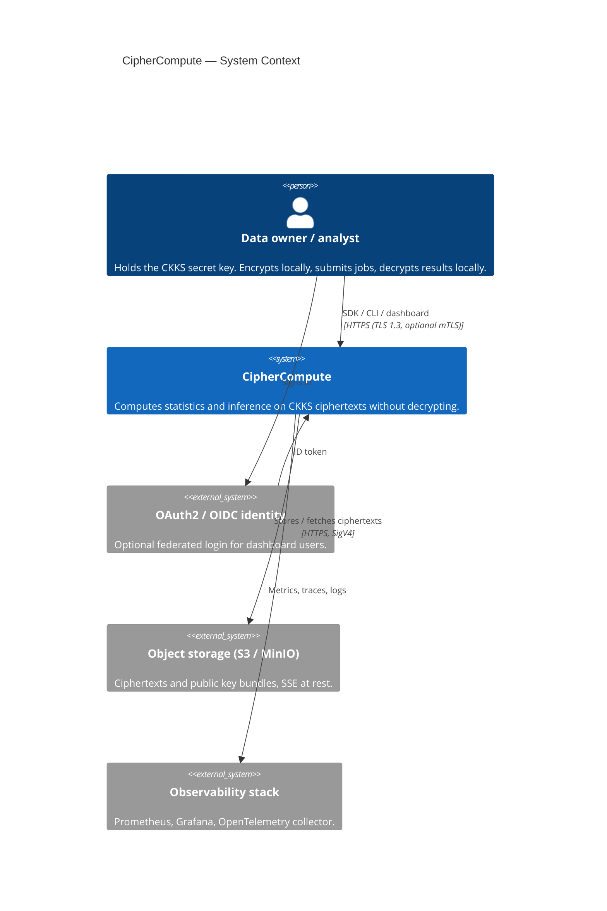
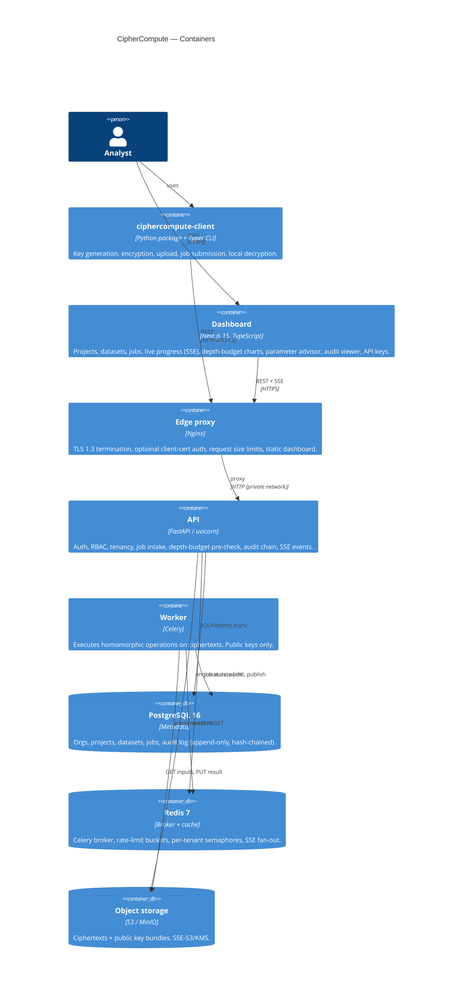
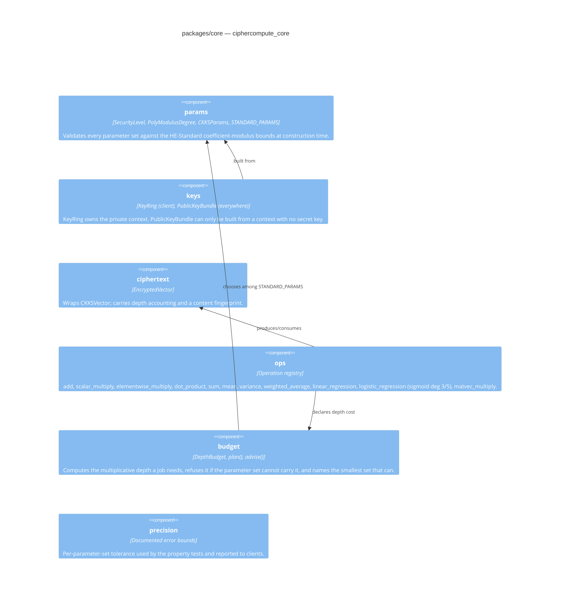
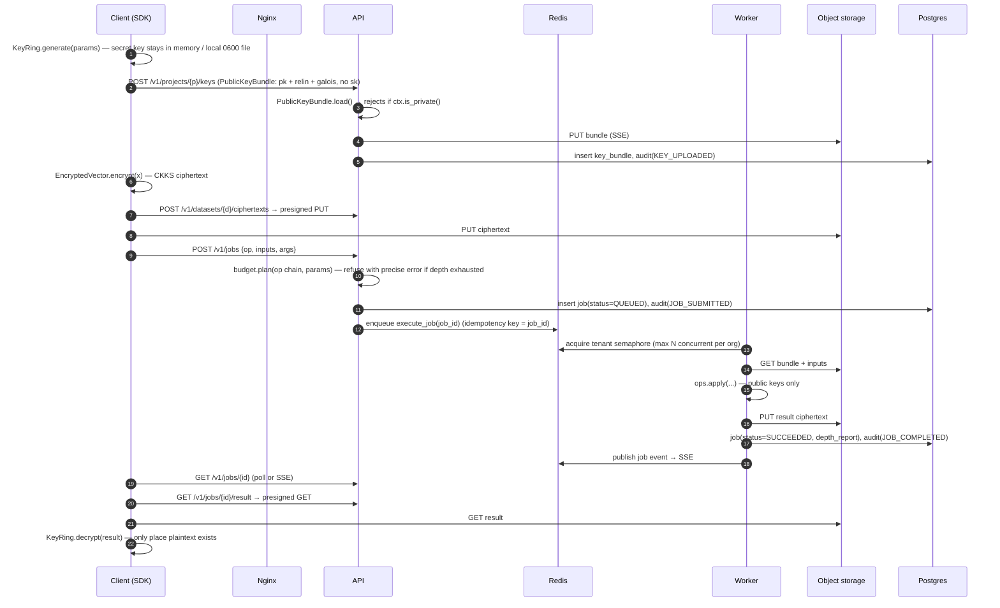

# CipherCompute — Architecture

CipherCompute is a multi-tenant analytics service that computes statistics and model
inference **on encrypted data**. Clients keep the secret key; the server only ever holds
public, relinearization and Galois keys plus CKKS ciphertexts. Nothing on the server can
turn a ciphertext back into a number.

This document is the single source of truth for the system shape. Security reasoning lives
in [THREAT_MODEL.md](THREAT_MODEL.md); operational procedures in [RUNBOOK.md](RUNBOOK.md).

---

## 1. Scheme and library choice

### 1.1 Why CKKS and not BFV/BGV

| Property | CKKS | BFV / BGV |
|---|---|---|
| Native data type | Approximate real/complex numbers | Exact integers mod `t` |
| Statistics (mean, variance, regression) | Natural: floats, fractional scalars (1/n, weights) | Requires fixed-point encoding, scaling tricks, and exact modular wrap-around management |
| Sigmoid / polynomial approximation | Direct: coefficients are floats | Needs integer-scaled polynomials; precision loss compounds |
| Rescaling | Built-in; controls magnitude growth per multiplication | No rescale; noise grows with plaintext modulus |
| Precision | ~`scale_bits − log2(error)` fractional bits, documented per parameter set (see §4) | Exact, but only for integers |
| Batching (SIMD slots) | `N/2` complex slots (we use the real part) | `N` integer slots |

Every workload in the product brief (vector statistics, weighted averages, linear and
logistic regression inference, matrix-vector products) is **real-valued**. CKKS is the
only mainstream scheme designed for approximate arithmetic over the reals, and its
rescaling operation is precisely what keeps a depth-2…8 statistics pipeline numerically
stable. BFV would force every client to agree on a fixed-point encoding and would make a
quantity as simple as `mean = sum × 1/n` awkward. The trade-off — CKKS results are
approximate — is explicitly documented and bounded by property-based tests
(`packages/core/tests/test_properties.py`).

### 1.2 Why TenSEAL (Microsoft SEAL) and not OpenFHE

We chose **TenSEAL 0.3.18**, the Python binding over **Microsoft SEAL 4.x**, and we never
mix it with another library.

* **Maintained on our target interpreter.** TenSEAL publishes `cp312` wheels for
  `manylinux`, `macosx` and `win_amd64`. The platform pins Python 3.12 (`pyproject.toml`
  `requires-python = ">=3.12,<3.13"`), so install is a plain `pip install`; no C++ toolchain
  in CI or on client machines.
* **SEAL-validated security.** SEAL refuses to build an encryption context whose
  coefficient modulus exceeds the HE-Standard bound for 128-bit security at the chosen
  `poly_modulus_degree`. We layer our own `SecurityLevel` validation on top so 192- and
  256-bit sets are enforced too (`packages/core/src/ciphercompute_core/params.py`).
* **A public/secret context split is first-class.** A TenSEAL context serialised with
  `save_secret_key=False` is structurally incapable of decryption; `ctx.is_private()` tells
  us at load time whether a secret key is present. The server rejects any private context
  at the boundary (§6.2).
* **Vector-native API.** `CKKSVector` exposes `add`, `mul`, `dot`, `sum`, `polyval`,
  `matmul` with automatic relinearisation and rescaling — the exact primitive set our
  operation registry needs.
* OpenFHE's Python bindings (`openfhe-python`) are excellent but at the time of writing
  require a compiled OpenFHE install and do not publish universal 3.12 wheels for all three
  platforms we support. That was the deciding factor; the cryptographic capabilities are
  comparable.

**Not negotiable:** the server process imports the core package's *public-only* API. There is
no code path in `services/` that constructs a private context, calls `decrypt`, or accepts a
serialised secret key. A CI test (`packages/core/tests/test_secret_key_boundary.py`) greps
the server and worker source for forbidden symbols and fails the build if one appears.

---

## 2. C4 — System context



## 3. C4 — Containers



## 4. C4 — Components (crypto core)



---

## 5. Data flow — one job, end to end



The server never calls `decrypt`. The only plaintext numbers that ever touch server memory
are **public job arguments** that are plaintext by design (scalar multipliers, model
weights, matrices) and which the client chose to disclose.

---

## 6. Design decisions

### 6.1 "Noise budget" in CKKS means *levels*, not BFV's invariant noise

BFV exposes an "invariant noise budget" in bits. CKKS does not have that notion: its
ciphertexts are *approximate by construction* and the quantity that gets consumed by
multiplication is the **modulus chain level**. Each ciphertext–ciphertext or
ciphertext–plaintext multiplication is followed by a rescale that drops one prime from the
coefficient modulus; when no primes are left, the next multiplication is impossible.

So the budget CipherCompute tracks and reports is:

* `levels_total = len(coeff_mod_bit_sizes) − 2` (first prime is consumed by the initial
  scale, the last one is the special key-switching prime),
* `levels_consumed` — summed from each operation's declared cost,
* `levels_remaining = levels_total − levels_consumed`,
* `scale_bits` and an **estimated precision** derived from the measured error bounds in
  `precision.py`.

The declared costs are not trusted blindly: `packages/core/tests/test_depth_regression.py`
measures the real remaining depth of the ciphertext produced by every operation chain
(by probing how many further multiplications the ciphertext can absorb) and asserts it
equals the declared value. Any drift — a TenSEAL upgrade that changes `polyval`'s
internals, for example — fails CI.

### 6.2 Secret key boundary (architectural, not procedural)

* `KeyRing` (client-only) is the sole owner of a private context. Its `public_bundle()`
  serialises with `save_secret_key=False`.
* `PublicKeyBundle.load()` raises `SecretKeyLeakError` if the loaded context reports
  `is_private()`. The API calls this at upload; the worker calls it again at execution.
* `services/` has an import-linter contract forbidding `ciphercompute_core.keys.KeyRing`,
  and a test greps the server/worker trees for `decrypt(`, `secret_key`, `save_secret_key=True`,
  `KeyRing`. Either hit fails the build.

### 6.3 Tenancy

`organization → project → dataset → {ciphertext, key_bundle} → job`. Every table that
belongs to a tenant carries `organization_id` (UUIDv7, generated in
`ciphercompute_core.ids.uuid7`). Every repository query goes through
`TenantScopedSession`, which **requires** an organization id and appends the predicate; there
is no "unscoped" query helper. A test exercises each repository method with two tenants and
asserts zero cross-tenant rows.

### 6.4 Idempotent, bounded execution

Celery tasks use `acks_late=True`, `task_reject_on_worker_lost=True`, exponential backoff
with jitter, and a `SELECT … FOR UPDATE SKIP LOCKED` on the job row so a duplicate delivery
is a no-op. A per-organization Redis semaphore (`tenant:{org}:running`) caps concurrent jobs;
excess work waits in the queue rather than starving other tenants.

### 6.5 Audit log integrity

`audit_events` is append-only at the database level (a trigger rejects `UPDATE`/`DELETE`,
see `services/api/alembic/versions/0001_initial.py`). Each row stores
`prev_hash` and `hash = SHA-256(prev_hash ‖ canonical-JSON(row))`. `GET /v1/audit/verify`
re-walks the chain; the dashboard shows the verification result.

### 6.6 Storage: two independent layers of encryption

1. **Client-side**: the payload *is* a CKKS ciphertext. Even a full object-store dump yields
   nothing without the client's secret key.
2. **At rest**: buckets enforce SSE (SSE-S3 locally on MinIO, SSE-KMS on AWS via Terraform).
   This protects the *public* key bundles and metadata and defends against disk-level
   exfiltration of the ciphertext store itself.

### 6.7 Process model and zero-downtime

API: gunicorn with uvicorn workers, graceful timeout 30 s, `SIGTERM` → stop accepting,
drain in-flight requests. Worker: Celery warm shutdown, `prefetch_multiplier=1` so a
terminating worker holds at most one job. Kubernetes: rolling update with
`maxUnavailable: 0`, readiness gates on DB + Redis + object storage, PodDisruptionBudget
`minAvailable: 1`.

---

## 7. Repository layout

```
packages/core/        ciphercompute_core   — crypto core (shared by SDK, API, worker)
packages/client/      ciphercompute_client — SDK + `ciphercompute` CLI
services/api/         ciphercompute_api    — FastAPI
services/worker/      ciphercompute_worker — Celery worker
dashboard/            Next.js 15 dashboard
infra/                docker, nginx, helm, k8s, terraform, observability
showcase/health-risk/ Encrypted Health Risk Scoring walkthrough
docs/                 whitepaper, API examples, ADRs
loadtest/             k6 scenarios + committed report
scripts/              backup / restore / release helpers
.github/workflows/    CI/CD
```

## 8. Standard parameter sets

Chosen so that `Σ coeff_mod_bit_sizes ≤ MaxBitCount(N, level)` from the HE Security
Standard (the table SEAL ships in `hestdparms.h`). All primes are ≤ 60 bits as SEAL requires.
Each `(N, level)` has two profiles: **balanced** (larger scale, more precision) and **deep**
(smaller scale, more levels). *Headroom* = first prime − scale bits: values and every
intermediate product or sum must stay below `2^headroom` or they wrap.

| N | Level | Profile | coeff_mod_bit_sizes | Σ bits | bound | depth | scale | headroom |
|---|---|---|---|---|---|---|---|---|
| 8192 | 128 | balanced | 60,40,40,60 | 200 | 218 | 2 | 2^40 | 20 |
| 8192 | 128 | deep | 45,30,30,30,30,45 | 210 | 218 | 4 | 2^30 | 15 |
| 8192 | 192 | balanced | 45,30,30,45 | 150 | 152 | 2 | 2^30 | 15 |
| 8192 | 192 | deep | 38,25,25,25,38 | 151 | 152 | 3 | 2^25 | 13 |
| 8192 | 256 | balanced | 36,23,23,36 | 118 | 118 | 2 | 2^23 | 13 |
| 8192 | 256 | deep | — | | 118 | | | *no viable set* |
| 16384 | 128 | balanced | 60,40×6,60 | 360 | 438 | 6 | 2^40 | 20 |
| 16384 | 128 | deep | 50,30×11,50 | 430 | 438 | 11 | 2^30 | 20 |
| 16384 | 192 | balanced | 55,35×5,55 | 285 | 305 | 5 | 2^35 | 20 |
| 16384 | 192 | deep | 45,30×7,45 | 300 | 305 | 7 | 2^30 | 15 |
| 16384 | 256 | balanced | 43,29×5,43 | 231 | 237 | 5 | 2^29 | 14 |
| 16384 | 256 | deep | 38,26×6,38 | 232 | 237 | 6 | 2^26 | 12 |
| 32768 | 128 | balanced | 60,40×8,60 | 440 | 881 | 8 | 2^40 | 20 |
| 32768 | 128 | deep | 60,40×14,60 | 680 | 881 | 14 | 2^40 | 20 |
| 32768 | 192 | balanced | 60,40×8,60 | 440 | 611 | 8 | 2^40 | 20 |
| 32768 | 192 | deep | 50,35×14,50 | 590 | 611 | 14 | 2^35 | 15 |
| 32768 | 256 | balanced | 50,35×8,50 | 380 | 476 | 8 | 2^35 | 15 |
| 32768 | 256 | deep | 45,30×12,45 | 450 | 476 | 12 | 2^30 | 15 |

Depth is `len − 2`. Two rules shaped every row, and both are *measured* rather than assumed:

1. **The special (last) prime is never smaller than the first prime.** RNS key switching —
   used by every relinearisation and rotation — adds noise of roughly
   `2^(largest prime − special prime) · N · σ`. Calibration of a (32,21,21,21,23) candidate
   returned *negative* precision bits (errors larger than the values); `CKKSParams` now rejects
   any chain whose special prime is smaller than another prime.
2. **Usable precision ≈ scale_bits − log₂N − 2 when fresh**, dropping 2–5 bits per level. That
   is why the 256-bit rows at N=8192 are cramped (118 bits cannot buy both precision and depth),
   why there is no deep 256-bit set at N=8192 at all, and why the advisor can be asked for a
   minimum precision (`advise(..., min_precision_bits=12)`) and will move to N=16384 instead.

### 8.1 Depth cost of each operation

| Operation | Levels | Notes |
|---|---|---|
| `vector_add`, `sum` | 0 | additions and rotations only |
| `scalar_multiply`, `elementwise_multiply`, `dot_product`, `mean`, `weighted_average`, `linear_regression`, `matvec_multiply` | 1 | one multiplication + rescale |
| `variance` | 2 | `E[x²] − E[x]²`, both branches aligned at two levels |
| `logistic_regression`, degree 3 | 3 | 1 for the logit + 2 for `polyval` |
| `logistic_regression`, degree 5 | 4 | 1 for the logit + 3 for `polyval` (`⌊log₂ d⌋ + 1`) |

Consequence worth knowing: encrypted logistic-regression inference does **not** fit the
balanced N=8192 sets (2 levels). `budget.plan()` refuses it with the exact set to use instead
(N=8192 *deep*, 4 levels, at 128-bit) — the showcase runs there.

### 8.2 Measured precision

`packages/core/src/ciphercompute_core/data/precision_table.json` holds, for every preset and
every level, the worst normalised error measured by `scripts/calibrate_precision.py`
(see `precision.py` for the error model). The property-based tests use exactly these bounds as
tolerances, and the whitepaper reports the full table.

**Precision depends on the key ring, not only on the parameters.** Hypothesis found failures that
the first calibration missed; tracing them showed that the absolute noise floor of rotation-heavy
operations (`sum`, `mean`, `dot_product` — 12 rotations each at N=8192) differs by 14-26x between
fresh key rings with identical parameters, with outliers near 100x. A bound measured on one ring is
therefore not a bound. Calibration now samples 12 key rings per N=8192 set and 4 per N=16384 set,
includes all-zero and constant inputs (the cases that expose the floor), and keeps a 16x margin
over the worst case observed. Practical consequence: the low-precision sets (192/256-bit at
N=8192) have only a few usable bits after a `sum`; the advisor's `min_precision_bits` option steers
clients to N=16384 when they need more.

Precision is kept **per operation class**. Slot-wise operations (add, multiply, element-wise and
feature-major regression) never key-switch; rotating operations (sum, mean, dot product, variance,
matrix-vector, sample-major regression) carry the key-switching floor. At N=8192/128-bit balanced
the measured, margin-adjusted figures are 22/18 bits slot-wise and 14 bits rotating. A job's depth
report states which class applies. Because a computation at depth L may contain any operation
measured at a shallower depth (a variance contains a sum), the bound reported at L is the worst
measurement at or below L, and an unmeasured level in between is bounded by its neighbours.
