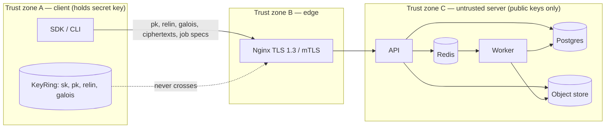

# CipherCompute — Threat Model (STRIDE)

**Scope.** The client SDK/CLI, the API, the worker, the queue, the metadata database, the
object store, and the network between them. Out of scope: the client's own host security
(malware on the analyst's laptop can read the secret key — no server-side control changes
that).

**Security goal, stated precisely.** The server must never be able to learn any plaintext
value of client data, even if every server component is fully compromised and its operator is
actively malicious. Secondary goals: tenants cannot read or influence each other's data; every
access and job is attributable and tamper-evident; the service degrades gracefully under abuse.

**What FHE does and does not give us.** CKKS (RLWE) provides *confidentiality* (IND-CPA). It
does **not** provide *integrity of computation* — a malicious server can return a wrong
ciphertext and the client cannot tell from the ciphertext alone. It also has a well-known
hazard: if a client ever hands the server its *decrypted* outputs, approximate-decryption
attacks (Li–Micciancio, EUROCRYPT 2021) can recover the secret key. Both facts shape the
mitigations below; neither is hand-waved.

## Trust boundaries

Assets, highest value first: (1) client secret keys, (2) plaintext data — exists only in zone A,
(3) API/JWT signing secrets and API keys, (4) tenant metadata and audit integrity,
(5) availability.

## Attacker profiles

| ID | Attacker | Capabilities assumed |
|---|---|---|
| A1 | Honest-but-curious server operator | Reads every byte of every server component, logs, DB, buckets, memory. Follows protocol. |
| A2 | Malicious server | A1 + alters stored ciphertexts, returns wrong results, replays, drops jobs, modifies code. |
| A3 | Network attacker | Observes/modifies traffic between client and edge. |
| A4 | Malicious tenant | Valid account in one organisation; tries to reach another's data or exhaust shared resources. |
| A5 | Credential thief | Obtains an API key, JWT, refresh token, or a client secret key file. |

## STRIDE register

Each mitigation names the enforcing code. Line numbers are regenerated by
`scripts/resolve_threat_refs.py`, which locates the `# [TM:<id>]` marker comment at each
mitigation site; CI fails if a marker is missing or the line in this file is stale.

### Spoofing

| ID | Threat | Attacker | Mitigation | Enforced at | Verified by |
|---|---|---|---|---|---|
| S-1 | Password guessing / credential stuffing | A5 | Argon2id (RFC 9106 "second recommended" parameters: 64 MiB, t=3, p=4); per-IP and per-account rate limits; generic failure message. | `services/api/src/ciphercompute_api/auth/passwords.py:13`, `services/api/src/ciphercompute_api/routers/auth.py:91` (TM:S-1) | `services/api/tests/test_auth.py::test_argon2id_parameters`, `::test_login_rate_limited` |
| S-2 | Stolen or guessed API key | A5 | Keys are 256-bit random with a `cc_` prefix for secret scanners; only the SHA-256 digest is stored; lookup by digest and verification with `hmac.compare_digest`; scopes; revocation; last-used tracking. | `services/api/src/ciphercompute_api/auth/api_keys.py:50` (TM:S-2) | `test_api_keys.py::test_key_never_stored_plain`, `::test_constant_time_compare` |
| S-3 | Forged or replayed JWT | A5 | HS256 with a ≥ 256-bit secret from the environment/secret manager; 15-minute access tokens; refresh tokens rotated on every use with *reuse detection* (a replayed refresh token revokes the whole family); `jti` deny-list on logout. | `services/api/src/ciphercompute_api/auth/tokens.py:76` (TM:S-3) | `test_auth.py::test_refresh_reuse_revokes_family` |
| S-4 | Impersonating the service to the client | A3 | TLS 1.3 only (`ssl.TLSVersion.TLSv1_3` as *minimum*) in the SDK; certificate verification on by default; optional mutual TLS (client certificate) terminated at Nginx. | `packages/client/src/ciphercompute_client/transport.py` `# [TM:S-4]`; `infra/nginx/nginx.conf` | `packages/client/tests/test_transport.py::test_tls13_minimum` |

### Tampering

| ID | Threat | Attacker | Mitigation | Enforced at | Verified by |
|---|---|---|---|---|---|
| T-1 | Editing or deleting audit rows | A2 | `audit_events` has a Postgres trigger rejecting `UPDATE`/`DELETE`; each row stores `prev_hash` and `hash = SHA-256(prev_hash ‖ canonical row)`; `GET /v1/audit/verify` re-walks the chain. | `services/api/alembic/versions/0001_initial_schema.py:397`, `services/api/src/ciphercompute_api/audit/chain.py:25`, `services/api/src/ciphercompute_api/db/models.py:317` (TM:T-1); migration `0001_initial` | `test_audit.py::test_chain_detects_tamper`, `::test_update_rejected_by_trigger` |
| T-2 | Altered ciphertext in storage → silently wrong result | A2 | **Residual risk, stated plainly:** FHE gives no computation integrity. Controls: SHA-256 fingerprint of every uploaded ciphertext stored and echoed in the job manifest; result carries the manifest hash; SDK `verify_sample()` re-computes a random subset of jobs on plaintext locally and raises on mismatch. Full verifiable computation is out of scope and documented in SECURITY.md. | `packages/core/src/ciphercompute_core/ciphertext.py:190` (TM:T-2); `packages/client/src/ciphercompute_client/verify.py` | `packages/client/tests/test_verify.py` |
| T-3 | Parameter downgrade (server picks weaker CKKS params) | A2 | The *client* chooses parameters. The server never constructs an encryption context from its own parameters — it only loads the client's public bundle — and validates the loaded parameters against the HE-Standard table before accepting the bundle. | `packages/core/src/ciphercompute_core/params.py:107` (TM:T-3) | `packages/core/tests/test_params.py::test_insecure_combos_rejected` |
| T-4 | Request/response modification in transit | A3 | TLS 1.3; HSTS at edge; no plaintext listener in production compose/Helm. | `infra/nginx/nginx.conf` | `infra/tests/test_nginx_conf.py` |

### Repudiation

| ID | Threat | Attacker | Mitigation | Enforced at | Verified by |
|---|---|---|---|---|---|
| R-1 | "I never submitted that job / read that dataset" | A4, A5 | Every data access and job submission writes an audit event with actor (user or API key id), organisation, IP, user-agent, request id and trace id; audit writes are in the same DB transaction as the action. | `services/api/src/ciphercompute_api/audit/service.py:95` (TM:R-1) | `test_audit.py::test_every_data_route_audited` (parametrised over the route table) |

### Information disclosure

| ID | Threat | Attacker | Mitigation | Enforced at | Verified by |
|---|---|---|---|---|---|
| I-1 | Server reads plaintext data | A1, A2 | Data is CKKS-encrypted client-side; the server holds public, relinearisation and Galois keys only. No decrypt path exists in `services/`. | `packages/core/src/ciphercompute_core/keys.py:116`, `packages/core/src/ciphercompute_core/keys.py:217` (TM:I-1) (`PublicKeyBundle.load` rejects `is_private()` contexts) | `packages/core/tests/test_secret_key_boundary.py` (loads a private context → `SecretKeyLeakError`; greps `services/` for `decrypt(`, `secret_key`, `KeyRing`, `save_secret_key=True`) |
| I-2 | Secret key accidentally uploaded | A1 | The key-upload request schema has a single opaque `bundle` field; it is parsed by `PublicKeyBundle.load`, which rejects private contexts *before* anything is persisted. The SDK's `public_bundle()` is the only serialiser exposed for upload and hard-codes `save_secret_key=False`. | `services/api/src/ciphercompute_api/routers/keys.py:78` (TM:I-2) | `test_keys.py::test_private_context_rejected_before_storage` |
| I-3 | Secrets in logs | A1 | A structlog processor redacts values whose key matches a secret pattern and any token-shaped string (`cc_…`, JWT, `-----BEGIN`); request bodies are never logged. | `services/api/src/ciphercompute_api/logging.py:59` (TM:I-3) | `test_logging.py::test_no_key_material_in_captured_logs` (captures all logs during a full key-upload + job flow and greps for key-material patterns) |
| I-4 | Timing side channels on secret comparison | A3, A4 | All comparisons of API keys, token hashes and HMAC signatures use `hmac.compare_digest`. Server-side FHE evaluation never touches the secret key, so its timing cannot leak plaintext. | `services/api/src/ciphercompute_api/auth/api_keys.py:60`, `services/api/src/ciphercompute_api/auth/tokens.py:139` (TM:I-4) | `test_api_keys.py::test_constant_time_compare`; Semgrep rule `rules/no-plain-secret-compare.yaml` |
| I-5 | Ciphertext metadata leaks (vector length, dataset size) | A1 | `size` of a `CKKSVector` is part of its serialisation. SDK offers `pad_to=` to fix the visible length; dataset row counts are tenant-private metadata, not exposed cross-tenant. Residual: ciphertext byte-length is observable. | `packages/core/src/ciphercompute_core/ciphertext.py:75` (TM:I-5) | `packages/client/tests/test_encrypt.py::test_padding_hides_length` |
| I-6 | Cross-tenant read | A4 | `TenantScopedSession` requires `organization_id` on every query — there is no unscoped repository API; object keys are prefixed `org/{organization_id}/…` and presigned URLs are generated server-side only for keys under the caller's prefix. | `services/api/src/ciphercompute_api/db/tenancy.py:43` (TM:I-6) | `test_tenancy.py` (two orgs, every repository method, asserts zero leakage) |
| I-7 | Object-store breach | A1 | Payloads are CKKS ciphertexts (useless without sk) **and** buckets enforce SSE (SSE-S3 on MinIO, SSE-KMS on AWS via Terraform `aws_s3_bucket_server_side_encryption_configuration`). | `services/api/src/ciphercompute_api/storage/objects.py:99` (TM:I-7); `infra/terraform/s3.tf` | `test_storage.py::test_put_sets_sse_header` |
| I-8 | Decryption-oracle attack (client leaks approximate decryptions) | A2 | The SDK has no API that transmits decrypted values; results are decrypted in `KeyRing.decrypt` and returned to the caller only. SECURITY.md instructs operators never to feed decrypted outputs back to the service. Residual: this is a client-behaviour control. | `packages/client/src/ciphercompute_client/client.py` `# [TM:I-8]` | `packages/client/tests/test_client.py::test_no_plaintext_result_endpoint` |
| I-9 | Internal details in error responses | A4 | Uniform error envelope `{code, message, request_id}`; stack traces only in logs. | `services/api/src/ciphercompute_api/app.py:167` (TM:I-9) | `test_errors.py::test_500_has_no_traceback` |

### Denial of service

| ID | Threat | Attacker | Mitigation | Enforced at | Verified by |
|---|---|---|---|---|---|
| D-1 | Oversized uploads | A4 | Nginx `client_max_body_size`; API enforces per-parameter-set maximum ciphertext size and per-org storage quota; uploads go directly to object storage via presigned PUT with `content-length-range`. | `services/api/src/ciphercompute_api/routers/ciphertexts.py:54`, `services/api/src/ciphercompute_api/storage/objects.py:142` (TM:D-1) | `test_ciphertexts.py::test_oversized_rejected` |
| D-2 | Depth-exhausting or pathological jobs | A4 | `DepthBudget.plan()` refuses any job whose chain exceeds the parameter set's levels *before* enqueue; per-job CPU time limit; `N=32768` jobs count 4× against the tenant semaphore. | `packages/core/src/ciphercompute_core/budget.py:153`, `services/api/src/ciphercompute_api/routers/jobs.py:113` (TM:D-2) | `packages/core/tests/test_budget.py::test_plan_refuses_and_advises` |
| D-3 | Request flooding | A4 | Per-API-key and per-IP token bucket in Redis; `429` with `Retry-After`. | `services/api/src/ciphercompute_api/ratelimit.py:30` (TM:D-3) | `test_ratelimit.py` |
| D-4 | Queue starvation of other tenants | A4 | Per-organisation concurrency semaphore in the worker; queue-depth and worker-starvation alerts in Prometheus; HPA on queue depth. | `services/worker/src/ciphercompute_worker/concurrency.py` `# [TM:D-4]` | `services/worker/tests/test_concurrency.py` |

### Elevation of privilege

| ID | Threat | Attacker | Mitigation | Enforced at | Verified by |
|---|---|---|---|---|---|
| E-1 | Role escalation (viewer → admin) | A4 | RBAC enforced by a FastAPI dependency on every mutating route; only `owner` may change roles; membership rows carry the role, not the user. | `services/api/src/ciphercompute_api/auth/rbac.py:14`, `services/api/src/ciphercompute_api/routers/organization.py:108` (TM:E-1) | `test_rbac.py` (matrix of role × route) |
| E-2 | API-key scope escalation | A4, A5 | Each route declares required scopes; keys cannot be created with scopes broader than the creating principal's role allows. | `services/api/src/ciphercompute_api/auth/api_keys.py:76` (TM:E-2) | `test_api_keys.py::test_scope_ceiling` |
| E-3 | Container escape / lateral movement | A2 | Distroless-style non-root images, read-only root FS, dropped capabilities, seccomp `RuntimeDefault`, Kubernetes `NetworkPolicy` default-deny with explicit allows. | `infra/docker/*.Dockerfile`; `infra/helm/ciphercompute/templates/networkpolicy.yaml` | Trivy + `infra/tests/test_k8s_policies.py` |
| E-4 | Presigned-URL / SSRF abuse | A4 | Clients never supply storage URLs; keys are derived server-side from tenant + ids; presigned URLs are short-lived (5 min). | `services/api/src/ciphercompute_api/storage/objects.py:92` (TM:E-4) | `test_storage.py::test_presign_only_under_tenant_prefix` |

### Replay (cross-cutting)

| ID | Threat | Mitigation | Enforced at | Verified by |
|---|---|---|---|---|
| P-1 | Replayed job submission → duplicate billing / compute | `Idempotency-Key` header (required by SDK, optional for raw API) stored for 24 h; same key returns the original job. Worker-side `FOR UPDATE SKIP LOCKED` makes duplicate deliveries no-ops. | `services/api/src/ciphercompute_api/idempotency.py:34` (TM:P-1); `services/worker/src/ciphercompute_worker/tasks.py` | `services/api/tests/test_jobs.py::test_idempotency`, `services/worker/tests/test_tasks.py::test_duplicate_delivery_noop` |
| P-2 | Replayed refresh token | Rotation with reuse detection (see S-3). | `services/api/src/ciphercompute_api/auth/tokens.py:144` (TM:P-2) | `test_auth.py::test_refresh_reuse_revokes_family` |

### Key compromise (cross-cutting)

| ID | Scenario | Impact | Mitigation |
|---|---|---|---|
| K-1 | Client secret key file stolen | Every ciphertext under that key ring is decryptable by the thief. | Key rings are per project; SDK stores the secret key with `0600` permissions and optional passphrase encryption (AES-256-GCM, key derived with Argon2id) — `packages/client/src/ciphercompute_client/keystore.py` `# [TM:K-1]`; RUNBOOK §"Key rotation" describes re-encrypting a dataset under a new ring and revoking the old bundle. |
| K-2 | JWT signing secret leaked | Attacker mints tokens for any user. | Secret lives only in the environment/secret manager; `kid` header supports rotation with a grace window (`CC_JWT_PREVIOUS_SECRET`) — `services/api/src/ciphercompute_api/auth/tokens.py:51` (TM:K-2); RUNBOOK §"Rotate JWT secret". |
| K-3 | API key leaked | Attacker acts within that key's scopes. | Revocation endpoint; audit trail of key usage; `cc_` prefix registered with GitHub secret scanning format. |
| K-4 | Object-store credentials leaked | Attacker downloads ciphertexts and public bundles. | Ciphertexts are useless without client sk (I-1); credentials are scoped IAM roles with bucket-prefix conditions in Terraform; SSE-KMS adds a second gate. |

## Residual risks (accepted, documented)

1. **No verifiable computation.** A malicious server can return wrong results (T-2). Detection is
   probabilistic via `verify_sample()`. Removing this risk requires SNARK-style proofs over FHE,
   which is research-grade and out of scope.
2. **Ciphertext size metadata** (I-5) is observable.
3. **Decryption-oracle discipline** (I-8) is a client-behaviour control.
4. **Plaintext job arguments** (scalars, model weights, matrices) are visible to the server by
   design; clients who need private weights must encrypt them and pay one extra level.
